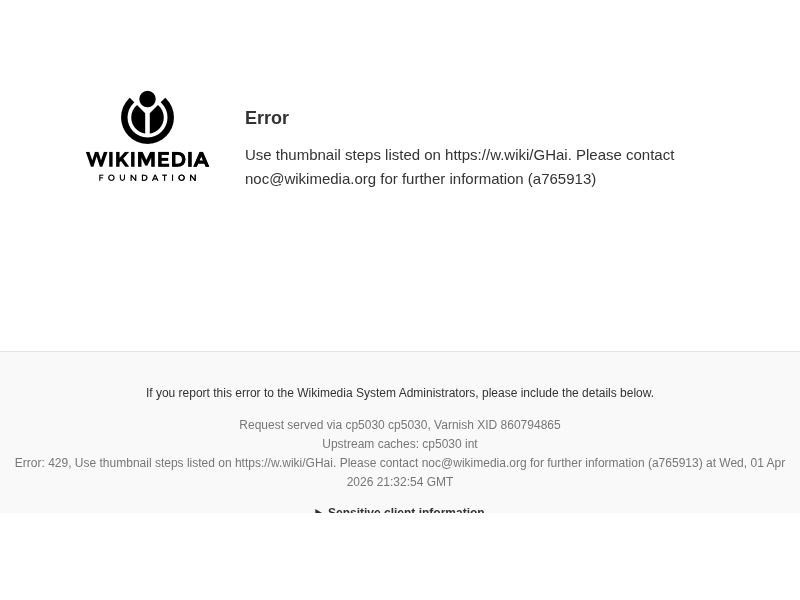
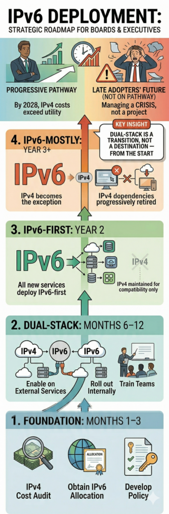

<!-- 
MARP Slide Deck: IPv6 Board & Executive Briefing
20-minute presentation for senior leaders, board members, and C-suite executives
Designed for strategic decision-making, not technical deep-dives
-->
<!-- _header: "" -->

# IPv6: A Board Briefing
### IPv4 slows down growth. IPv6 enables it.

---

# What We Will Cover

**The core message:** IPv4 slows down growth. IPv6 enables it.

- Why IPv4 is a barrier — not just a cost
- The global transition already underway
- What the Pacific stands to gain
- What your organisation needs to decide

> **20 minutes. No jargon. Clear decisions.**

---

# Section 1: The Internet's Address Crisis

---

## The Internet Has Run Out of Addresses

- The Internet runs on numbered addresses (like phone numbers)
- **IPv4** supports ~4.3 billion addresses — now all allocated
- Global pool (IANA) exhausted: **February 2011**
- Asia Pacific (APNIC): **April 2011**
- Europe (RIPE NCC): **September 2012**
- Latin America (LACNIC): **June 2014**
- North America (ARIN): **September 2015**
- Workarounds exist — they add expense, complexity, and operational risk

> **This is not a future problem. It is a present one.**

---

## From Scarcity to Abundance

| | IPv4 | IPv6 |
|---|---|---|
| **Address space** | 4.3 billion | 340 undecillion |
| **Per person** | Less than 1 | Billions |
| **Cost trend** | Peaked 2022; now declining | Standard deployment |
| **Workarounds needed?** | Yes — CGNAT, NAT | No |
| **End-to-end connectivity** | Compromised | Restored |
| **Impact on growth** | **Slows it down** | **Enables it** |

> IPv6 was designed to solve this problem and has been production-ready for over a decade.

---

## What Your Organisation Is Probably Already Doing

- Using **CGNAT** — sharing one address with thousands of others
- Paying a **premium** for IPv4 addresses on secondary markets
- Running **dual-stack** infrastructure without a plan
- Relying on vendors to "handle it" — without governance oversight

> **These are operational costs and risks already on your books.**

---

# Section 2: Strategic Risk & Business Case

---

## The Cost of Inaction — Operations

- IPv4 addresses: **$60+ (2022 peak) → $14–25 (Oct 2026)** — still falling
- All major vendors (Cisco, Juniper, Arista, Dell) have shipped IPv6-capable hardware as standard since the mid-2010s — **no additional licensing cost**
- CGNAT infrastructure costs, complexity, and helpdesk burden remain regardless
- Continuing to lease IPv4 is a **"laziness tax"** — paying a premium for inertia

> The transition cost is now organisational, not technical. Leadership is the bottleneck.

<small>_RFC 9386 (IETF, 2023): new equipment and most operating systems have supported IPv6 for many years. The barrier is no longer hardware._</small>

---

## The Cost of Inaction — Strategy

- **IPv4 actively constrains growth** — IoT, 5G, and cloud-native services need address space that IPv4 cannot provide
- Reduced performance for customers already on IPv6-only networks
- Policy direction is moving toward **IPv6 mandatory, IPv4 optional** — organisations that wait face mandates, not choices
- Vendor lock-in to legacy workarounds

> Every year on IPv4 is a year your infrastructure cannot grow at full speed.

---

## The IPv4 Market Is Closing

- **IEISI projection:** $60+ (2022) → ~$20 (2025) → below $10 (2026–27) → economically worthless (2028)
- **October 2026 actual:** ~$14–25 per address by block size — large blocks ~$14, /24s ~$25 (IPv4.Global prior sales, 9–17 Oct 2026)
- Bid-ask spread is now unbridgeable — sellers expect $50+, buyers offer $20
- IPv4 addresses are *technical debt*, not assets — their value was always artificial scarcity, not inherent utility
- Once substitution costs reach zero, the asset doesn't gradually depreciate — it **crashes to scrap value**
- On current trends, dual-stack operational costs exceed IPv4 utility by **2028**

> This is not a cyclical correction. The IPv4 market has a known end date — and it is close.

<small>_Sources: IPv4.Global prior sales, October 2026; [IPv4 Address Sale Price Trends](https://medium.com/@terrysweetser_90287/ipv4-address-sale-price-trends-abf45620d34f) — Terry Sweetser, IEISI_</small>

---

## Global Adoption Is Already Underway

- Global: **~44%** IPv6-capable (APNIC Labs) / **~51%** of Google traffic over IPv6
- India: **~76%** — the world's largest IPv6 deployment, driven by Reliance Jio
- France: **~86%**; Germany: **~73%** — European leaders
- USA: **~62%** IPv6-capable across all traffic
- Australia: **~48%**; New Zealand: **~33%** — both with room to grow
- Pacific Islands: domestic operators at an early stage — a **first domestic-mover opportunity**
- Without policy intervention, universal adoption is projected for the **mid-2040s**

> Waiting for the market to force the transition means waiting two decades.

<small>_Sources: APNIC Labs, 30 days to 2026-10-18; Google IPv6 statistics 51% (2026-10-19); mid-2040s: Huston, "The IPv6 transition", APNIC Blog, Oct 2024._</small>

---

## Pacific IPv6 Today: Who Is Delivering It?

| Economy | IPv6-capable users | Carried by Starlink | Domestic operators |
|---|---|---|---|
| Kiribati, Nauru, Tuvalu | 50–57% | ~100% | 0% |
| Cook Islands, Samoa, FSM, Vanuatu | 10–41% | ~100% | 0% |
| Solomon Islands, Marshall Islands | 15–30% | ~96% | SATSOL 9%; others 0% |
| Tonga | 31% | ~47% | Tonga Communications 29% |
| PNG | 27% | ~13% | Digitec 52% |
| Fiji | 41% | ~5% | Vodafone Fiji 61% |

> Starlink delivers IPv6 to your citizens today. Most domestic operators deliver none. Fiji and PNG show it can be done. **IPv4 slows down growth. IPv6 enables it.**
> <small>_Source: APNIC Labs per-network data, 30 days to 2026-10-18; Starlink = AS14593. Small samples for Vanuatu, Nauru, Tuvalu._</small>

---

## IPv4 Scarcity Is Not Neutral

- Early-adopting regions (North America, Europe) hold **vast legacy allocations**
- Late-adopting regions (Pacific, Africa, South Asia) face scarcity-driven costs
- IPv4 leasing markets extract **economic rents from developing economies**
- Scarce capital is diverted from infrastructure into address fees
- IPv6 eliminates regional inequity — **abundant address space, no legacy advantage**

> IPv4 slows down growth for the Pacific. IPv6 levels the playing field.

---

## Competitive and Strategic Upside

**Operational efficiency**
- Simplified network architecture — remove NAT layers
- Lower long-term address costs

**Growth enablement**
- IoT, smart infrastructure, and 5G need vast address space

**Reputational positioning**
- Demonstrates digital maturity to partners and regulators
- Aligns with SDG 9 (Industry, Innovation, Infrastructure)

> IPv6 is infrastructure for the next 30 years.

---

# Section 3: Security — Myth vs. Reality

---

## "But Isn't IPv6 Less Secure?"

**The myth:** NAT provides security
**The reality:** NAT is an address workaround, not a security control

**What does not change with IPv6:**
- Firewalls are still required — and still work
- Encryption standards (TLS, IPsec) are unchanged
- Access control policy remains your organisation's responsibility

> Security posture is determined by policy and architecture — not protocol version.

---

## NAT Is Not Security

- NAT hides internal addresses — it does **not** inspect, filter, or block threats
- Malware, phishing, and insider threats all operate freely behind NAT
- NAT breaks end-to-end connectivity — it does not protect it
- A firewall with no NAT is more secure than NAT with no firewall
- **NIST, ISO 27001 and CIS all require you to govern what is on your network — NAT does not do that; firewalls and policy do**

> If your security strategy depends on NAT, you do not have a security strategy.

---

## Governance Implication: You Need a Policy

Organisations without an IPv6 policy face:
- Unmanaged IPv6 traffic (it is already on most networks)
- Shadow addressing — devices self-assigning addresses
- Security tools that only monitor IPv4

**Board-level question:**
> Does our security policy explicitly cover IPv6?

If the answer is "we don't know" — that is the first action item.

---

# Section 4: Where You Stand & What to Decide

---

## Why Adoption Stalls — It Is Not About Knowledge

- Research across 147 meta-analyses shows knowledge-based interventions have **negligible effect** on behaviour change
- Organisations understand IPv6 is needed — they have for years
- What actually drives change: **access, defaults, incentives, and social proof**
- HTTPS succeeded not through education — but through free certificates, browser defaults, and SEO incentives
- IPv6 stalls where it is still harder, more expensive, or riskier than doing nothing

> "The question isn't whether people understand the need for IPv6. It's whether we've made IPv6 deployment the natural, obvious, easy choice."

<small>_Source: Internet Society Pulse, September 2025 — [Why IPv6 Adoption Is Stalled](https://pulse.internetsociety.org/en/blog/2025/09/why-ipv6-adoption-is-stalled-the-behavioral-science-behind-internet-infrastructure-change/); primary: Albarracín et al., Nature Reviews Psychology, 2024_</small>

---

## A Simple Maturity Model

| Stage | Description | Typical Organisations |
|---|---|---|
| **Unaware** | IPv6 not on the radar | Small/legacy operators |
| **Aware** | Knows it's needed, no plan | Most organisations today |
| **Planning** | Strategy and roadmap in development | Proactive leaders |
| **Deploying** | Active dual-stack rollout | Progressive operators |
| **IPv6-first** | IPv6 default, IPv4 legacy | Major ISPs, hyperscalers |

> **Where are you? Where do you need to be?**

---

## Typical Deployment Pathway

**Months 1–3 — Foundation**
- Audit IPv4 costs; obtain IPv6 allocation; develop policy

**Months 6–12 — Dual-Stack**
- Enable IPv6 on external services; roll out internally; train teams

**Year 2 — IPv6-First**
- All new services deploy IPv6-first; IPv4 maintained for compatibility only

**Year 3+ — IPv6-Mostly**
- IPv4 dependencies progressively retired; IPv4 becomes the exception

> Dual-stack is a transition, not a destination — plan your exit from the start.
> On current trends, by 2028 IPv4 operational costs exceed utility. Organisations not yet on this pathway will be managing a crisis, not a project.

---

## Questions to Ask Your Technical Team

1. What percentage of our traffic is currently over IPv6?
2. Do we have an IPv6 address allocation from our ISP or RIR?
3. Does our security policy explicitly cover IPv6?
4. What is our annual spend on IPv4 addresses?
5. Which of our vendors and cloud providers support IPv6?
6. Do we have a target date for dual-stack deployment?
7. **What is our plan to move beyond dual-stack to IPv6-first?**

> Dual-stack is a transition, not a destination. Planning beyond it needs to start now.

---

# Section 5: The Governance Framework

---

## Who Runs the Internet?

- **IANA / ICANN** — coordinates global address policy
- **Regional Internet Registries (RIRs)** — regional allocation
  - APNIC covers Asia Pacific
- **IETF** — develops technical standards (including IPv6)
- **Your ISP** — your direct relationship for address allocation
- **Your organisation** — responsible for your own deployment

> IPv6 addresses are allocated, not purchased.

---

## APNIC: Your Regional Resource

**What APNIC provides:**
- IPv6 address allocation and policy
- Training and capacity building
- Open adoption data (APNIC Labs)
- Participation in Internet governance forums

**Relevance to your board:**
- Membership is low-cost relative to IPv4 market prices
- Training available for both technical and leadership staff
- Your adoption contributes to national and regional readiness

---

# Section 6: Recommendations & Next Steps

---

## Board-Level Recommendations

**Immediate (within 90 days)**
- Direct ICT to produce an IPv6 readiness report
- Include IPv6 in the next ICT strategy review
- Confirm IPv6 coverage in the security policy

**Medium-term (within 12 months)**
- Approve a deployment roadmap with milestones and budget
- Include IPv6 KPIs in ICT reporting to the board
- Engage APNIC or your ISP on address allocation

**Ongoing**
- Monitor APNIC Labs adoption benchmarks
- Make IPv6 a mandatory procurement criterion
- Remove structural barriers: make IPv6 the default, not the exception

---

## The One-Slide Summary

| | |
|---|---|
| **The message** | IPv4 slows down growth. IPv6 enables it. |
| **The problem** | IPv4 is exhausted — workarounds cap your potential |
| **The solution** | IPv6 — abundant, global, production-ready |
| **The risk** | Inaction means constrained growth and rising costs |
| **Your role** | Commission the plan, approve the roadmap |

> IPv6 is not a technical project. It is a growth decision.

---
# Thank You

### Questions & Discussion

**Further resources:**
- APNIC Academy: academy.apnic.net
- APNIC Labs adoption data: labs.apnic.net
- [Why IPv6 Adoption Is Stalled — Internet Society Pulse](https://pulse.internetsociety.org/en/blog/2025/09/why-ipv6-adoption-is-stalled-the-behavioral-science-behind-internet-infrastructure-change/)
- [IPv4 is Technical Debt](https://medium.com/@terrysweetser_90287/ipv4-is-technical-debt-fa6449dc06d4)
- [IPv4 Address Sale Price Trends](https://medium.com/@terrysweetser_90287/ipv4-address-sale-price-trends-abf45620d34f)
- [IPv6 Mandatory, IPv4 Optional](https://medium.com/@terrysweetser_90287/ipv6-mandatory-ipv4-optional-rethinking-address-policy-for-equity-and-sustainability-e698d4973459)
- IPv6 for Leaders workshop (full day): [www.ieisi.org/training](https://www.ieisi.org/training)

**Contact:**
tcs@ieisi.org | www.ieisi.org
